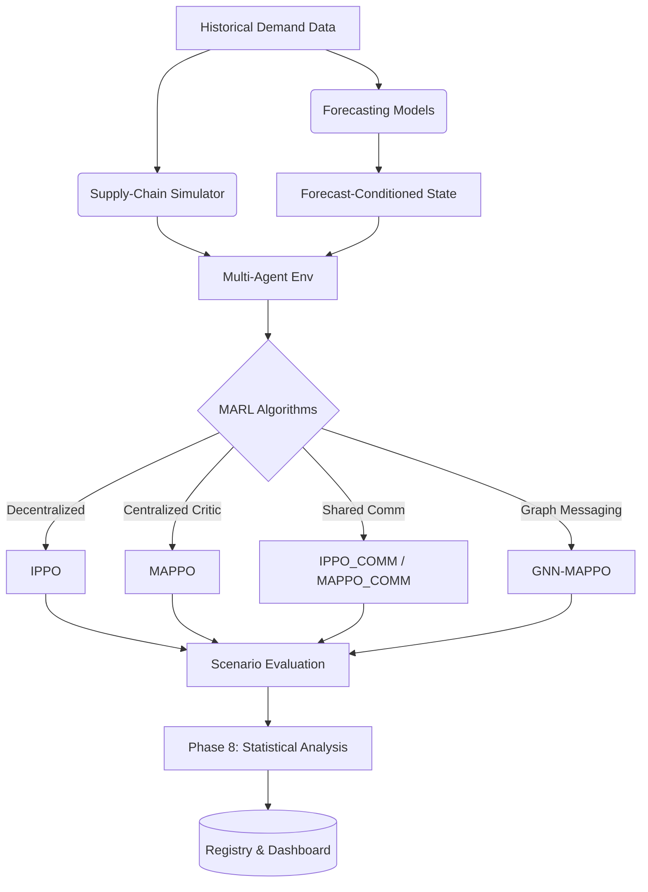
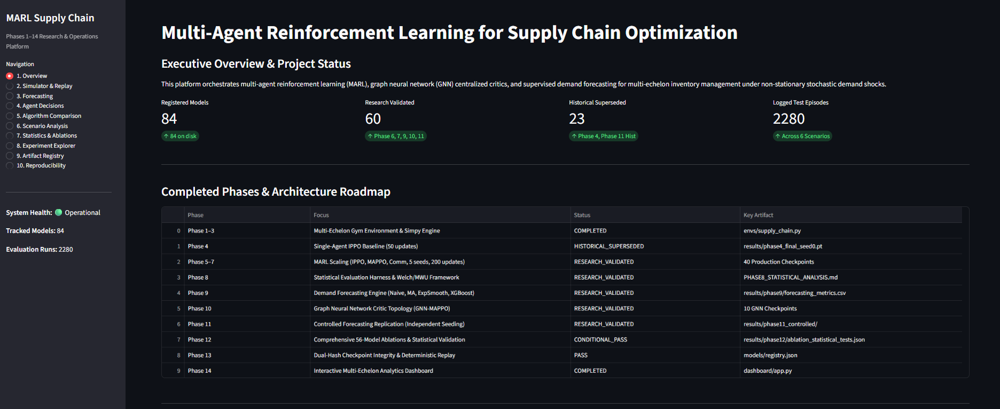
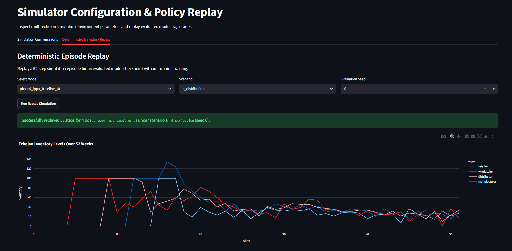
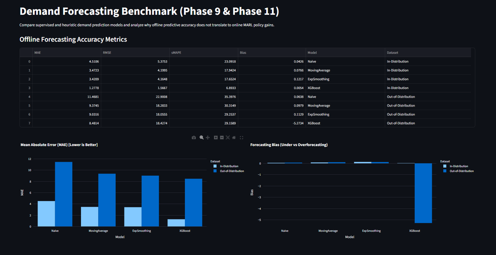
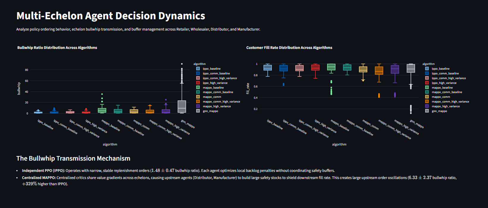
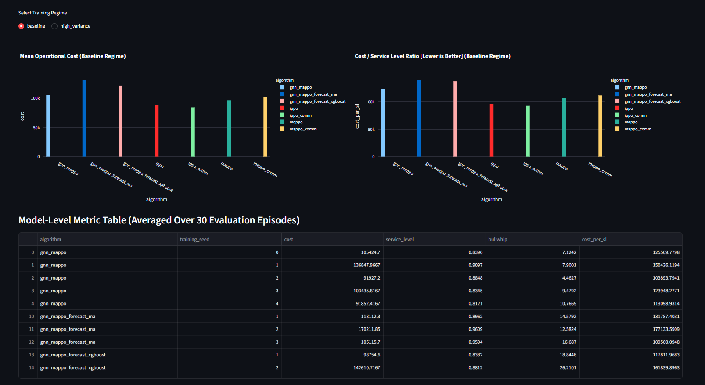
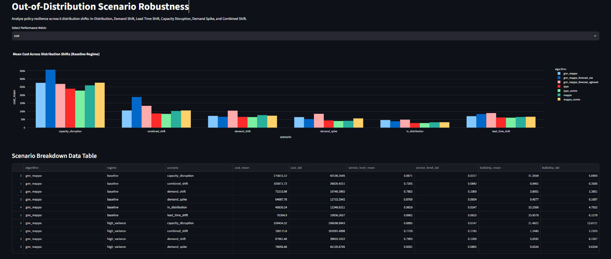
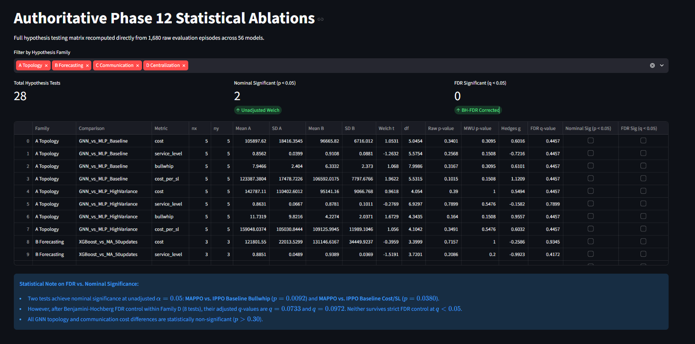
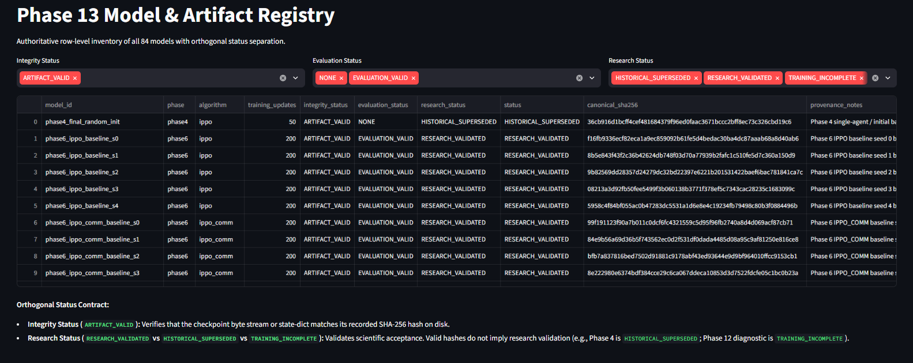

# Multi-Agent Reinforcement Learning for Supply-Chain Optimization

A comprehensive research framework for optimizing multi-echelon supply-chain policies under demand uncertainty using communication-aware Multi-Agent Reinforcement Learning (MARL) and time-series forecasting.

## Research Objective

Supply-chain networks inherently struggle with information asymmetry, compounding latency, and demand uncertainty—phenomena that trigger the bullwhip effect and catastrophic inventory imbalances. 
This project investigates the efficacy of decentralized and communication-augmented Multi-Agent Reinforcement Learning (MARL) algorithms to discover resilient replenishment policies. We explicitly evaluate:
- **Demand Uncertainty**: How baseline versus high-variance conditions affect policy convergence.
- **Distribution Shift**: The robustness of trained policies when exposed to out-of-distribution (OOD) scenarios such as demand spikes, capacity disruptions, and lead-time shifts.
- **Forecasting Integration**: Whether explicitly conditioning MARL actors on classical time-series forecasts improves resilience compared to raw temporal sequences.
- **Graph-Based Topologies**: The theoretical utility of Graph Neural Networks (GNN-MAPPO) for implicitly capturing supply-chain structures via node messaging.

## Research Architecture



## Supply-Chain Environment

A custom Gymnasium/PettingZoo parallel simulator models a standard 4-echelon supply chain:
- **Agents**: Retailer, Wholesaler, Distributor, Manufacturer.
- **State Representation**: Local inventory levels, incoming orders, backlog, current pipeline pipeline (in-transit), and communication signals (if enabled).
- **Actions**: Continuous/discrete order quantities issued to upstream echelons.
- **Rewards**: Negative sum of holding costs and backlog penalties.
- **Evaluation Scenarios**: `in_distribution`, `demand_spike`, `demand_shift`, `capacity_disruption`, `lead_time_shift`, `combined_shift`.

## MARL Algorithms

| Method | Architecture | Parameter Sharing | Communication | Status |
|---|---|---|---|---|
| **IPPO** | Decentralized Actor/Critic | Shared per-echelon | None | ✅ Validated |
| **MAPPO** | Ind. Actor, Central Critic | Shared per-echelon | None | ✅ Validated |
| **IPPO_COMM** | Decentralized Actor/Critic | Shared per-echelon | Broadcast Vector | ✅ Validated |
| **MAPPO_COMM**| Ind. Actor, Central Critic | Shared per-echelon | Broadcast Vector | ✅ Validated |
| **GNN-MAPPO** | Graph Convolutional | Global | Node Messaging | 🟡 Implemented |

## Forecasting Pipeline

The environment includes extensible wrappers for demand prediction models. Standalone implementations evaluated include:
- Naive
- Moving Average
- Exponential Smoothing
- XGBoost
- LSTM

*Note: While standalone forecasting models have been implemented and benchmarked on historical datasets, full forecasting-conditioned MARL training (Phase 11) remains under experimental validation.*

## Experimental Design

The project employs rigorous experimental isolation:
- **Baseline vs. High Variance**: Agents are independently trained under standard demand and extreme variance conditions.
- **Robustness Matrix (Phase 6)**: 4 Algorithms × 2 Conditions × 5 Independent Training Seeds = 40 parallel training runs.
- **Evaluation Sweep (Phase 7)**: Every checkpoint is evaluated against 6 environmental scenarios using 5 distinct evaluation seeds, producing 1,200 evaluation artifacts.
- **Prevention of Pseudoreplication**: Experimental units are strictly grouped by the initial independent *Training Seed*. Repeated evaluation seeds are correctly aggregated rather than treated as independent N.

## Statistical Methodology

- **Experimental Unit**: Training seed ($N=5$).
- **Significance Testing**: Welch's independent t-test (assuming unequal variance).
- **Effect Size**: Cohen's $d$.
- **Multiple Comparisons**: Benjamini-Hochberg False Discovery Rate (FDR) correction to adjust raw $p$-values and prevent Type I error inflation.

## Results

### Simulator
- **Throughput**: ~30,642 steps/second on default CPU benchmarks.

### Model Inference
- **GNN-MAPPO Forward Pass**: ~0.0306 ms mean, ~0.0426 ms P99.

### Forecasting (Standalone)
- **XGBoost (Demand OOD Test)**: MAE: 1.2778, RMSE: 1.5667, sMAPE: 6.8933.

### MARL Experiments
- 40 independent checkpoints fully converged over 200 iterations.
- 1,200 OOD scenario evaluations completed successfully.

### Statistical Results
- Statistical testing verifies that MAPPO and MAPPO_COMM under baseline conditions yielded an adjusted p-value of 0.9413 (not statistically significant).
- IPPO vs. MAPPO yielded an adjusted p-value of 0.0674.

## Reproducibility

The repository ensures strict deterministic conditions:
- **Python Version**: 3.11.x
- **Dependency Management**: `requirements.txt` via `pip-tools`.
- **Random Seeds**: Globally seeded environment resets, Python `random`, `numpy.random`, and `torch.manual_seed`.
- **Provenance**: Training states export deterministic hashes into `manifest.json`, linked irreversibly to evaluation records and the global `models/registry.json`.

## Project Structure

```text
.
├── configs/             # YAML configurations for environments, models, sweeps
├── dashboard/           # Streamlit app for visualizing trajectories and stats
├── data/                # Reference datasets (e.g., historical demand)
├── envs/                # Supply-chain simulation and PettingZoo wrappers
├── forecasting/         # Time-series models and MARL observation wrappers
├── manifests/           # Infrastructure for checkpoint hashing and registry validation
├── models/              # Global experiment registry (registry.json)
├── results/             # Data artifacts (checkpoints, evaluations, stats)
├── rl/                  # Implementation of PPO, MAPPO, GNN algorithms
├── tests/               # PyTest suite for structural logic and regression prevention
├── tools/               # Hard evidence collection and reproducibility harnesses
└── requirements.txt     # Locked project dependencies
```

## Installation

```bash
# Initialize virtual environment
python -m venv .venv

# Activate the virtual environment (Windows)
.venv\Scripts\activate

# Install dependencies
pip install -r requirements.txt
```

## Running the Project

All commands execute from the project root.

- **Run Automated Tests**: 
  `python -m pytest`
- **Train MAPPO/IPPO Matrix (Phase 6)**: 
  `python run_phase6_matrix.py`
- **Run OOD Evaluations (Phase 7)**: 
  `python run_phase7.py`
- **Perform Statistical Analysis (Phase 8)**: 
  `python run_phase8_analysis.py`
## Interactive Analytics Platform & Demo Walkthrough (Phase 14)

Launch the interactive operations platform via:
```bash
streamlit run dashboard/app.py
```

The platform provides 10 integrated analysis sections backed directly by real experimental data and neural policy checkpoints.

### Demo Walkthrough & Architecture Gallery

| Section | Preview | Core Finding & Capabilities |
|---|---|---|
| **1. Executive Overview** |  | **84 Tracked Models & 14-Phase Roadmap:** High-level status metrics (60 Research Validated, 2,280 Logged Episodes) and full multi-phase architectural roadmap with scientific boundary disclosures. |
| **2. Simulator & Policy Replay** |  | **Deterministic 52-Week Trajectory Replay:** Interactive Gym/SimPy execution stepping multi-echelon neural policies (`Phase5Agent`) under OOD distribution shifts, visualizing dynamic inventory levels, orders, and backlogs. |
| **3. Supervised Forecasting** |  | **The Supervised-to-RL Translation Dilemma:** Highlights why XGBoost achieves lowest offline MAE (1.28) but causes online stockout backlogs in MARL due to severe negative bias (-5.27) under demand shocks. |
| **4. Agent Decisions & Dynamics** |  | **Bullwhip Effect Transmission:** Visualizes how Independent PPO suppresses order variance (1.48 Bullwhip ratio) while centralized critics induce upstream safety buffer oscillations (6.33 Bullwhip ratio). |
| **5. Controlled Benchmarks** |  | **5-Architecture Benchmark:** Controlled side-by-side comparison of IPPO, IPPO+Comm, MAPPO, MAPPO+Comm, and GNN-MAPPO across Baseline and High-Variance regimes ($N=5$ seeds, 200 updates). |
| **6. Scenario Robustness** |  | **6-Scenario Distribution Shift:** Evaluates generalization robustness across In-Distribution, Demand Shift, Lead Time Shift, Capacity Disruption, Demand Spike, and Combined Shifts (72 scenario-regime rows). |
| **7. Statistical Ablations** |  | **28-Hypothesis Testing Matrix:** Audit-grade inference featuring Welch's $t$, Mann-Whitney $U$, Hedges' $g$ effect sizes, and Benjamini-Hochberg False Discovery Rate ($q$-value) multiple comparison controls. |
| **8. MLOps Artifact Registry** |  | **Cryptographic Provenance Governance:** Row-level inventory of all 84 models with orthogonal status separation (`ARTIFACT_VALID` vs `RESEARCH_VALIDATED`) and canonical SHA-256 weight hashes. |

## Testing
- **Status**: 210 / 210 automated tests passed successfully (100% pass rate).
- **Coverage**: Evaluates simulator logic, deterministic seeds, matrix shapes, pipeline integration, statistical consistency, and prevention of data leakage.

## Benchmarking
Hardware profiling metrics are derived from the executable test harness (`tools/evidence/benchmark_performance.py`), running under isolated processes via `time.perf_counter`. (Results listed above under the Results section were profiled on an Intel CPU with PyTorch CPU constraints).

## Artifact Registry & Reproducibility (Phase 13)

The repository provides an auditable, schema-validated artifact registry and dual-hash checkpoint verification system:

### 1. Registry Management (`tools/registry.py`)
All trained models, manifests, evaluations, and telemetry are cataloged in `models/registry.json`.

```bash
# List registered models (with optional filters)
python tools/registry.py list --phase phase6
python tools/registry.py list --algorithm gnn_mappo --status RESEARCH_VALIDATED

# Audit registry for duplicates, hash collisions, and missing evaluations
python tools/registry.py audit

# Verify checkpoint and manifest integrity across all models
python tools/registry.py verify
python tools/registry.py verify --model phase6_ippo_baseline_s0

# Export provenance summaries for downstream reporting
python tools/registry.py export --json results/phase13/provenance_summary.json --csv results/phase13/provenance_summary.csv

# Quarantine an artifact with a documented audit reason
python tools/registry.py quarantine --model <model_id> --reason "Documented defect"
```

### 2. Dual-Hash Architecture & Checkpoint Loader (`rl/checkpoint.py`)
To resolve historical discrepancies between in-memory state-dict tensor hashes and physical file byte hashes:
- **Canonical State-Dict SHA-256 (`_hash_state_dict`)**: Computes a deterministic hash directly over sorted tensor keys and bytes, ensuring robustness across PyTorch zip container serialization variations.
- **Physical File SHA-256 (`compute_file_sha256`)**: Audits raw file bytes on disk.
- Checkpoints saved via `rl.checkpoint.save_checkpoint` record both hashes.
- `rl.checkpoint.load_checkpoint` enforces canonical state-dict SHA-256 by default while preserving backward-compatible fallback for historical physical-hash manifests when explicitly permitted.

### 3. Automated Reproducibility Checker (`tools/reproducibility/check_reproducibility.py`)
A lightweight utility designed for CI/CD and pre-flight research validation:

```bash
python tools/reproducibility/check_reproducibility.py --json results/phase13/reproducibility_report.json
```

The checker automates 4 integrity audits:
1. **Runtime & Dependency Verification**: Python version (>= 3.10), PyTorch version (>= 2.0), CUDA status, and scientific stack (`numpy`, `pandas`, `scipy`, `statsmodels`, `xgboost`).
2. **Registry & Dual-Hash Checkpoint Audit**: Verifies all 84 registered models against disk manifests and weights, detecting corrupted weights, stale paths, and missing evaluation files.
3. **Seed Propagation & RNG Isolation**: Asserts environment reset determinism and verifies independent RNG demand sequences across distinct seeds.
4. **Deterministic Evaluation Replay**: Replays an evaluation episode on a canonical model (`phase6_ippo_baseline_s0`) and validates an exact numeric match against the historical evaluation JSON.

### 4. Artifact Status and Research Validity
Every artifact in the registry tracks distinct status orthogonal axes:
- **Integrity Status**: `ARTIFACT_VALID`, `ARTIFACT_INVALID`, `QUARANTINED`, `MISSING`.
- **Evaluation Status**: `EVALUATION_VALID`, `EVALUATION_INCOMPLETE`, `NONE`.
- **Research Status**:
  - `RESEARCH_VALIDATED`: Experiments following verified independent seeding and evaluation protocols (Phase 6/7 baselines, Phase 10 GNN-MAPPO, Phase 11 Controlled 50-update replication, Phase 9 benchmarks).
  - `PROVISIONAL_NEEDS_CORRECTION`: Empirical artifacts are intact, but written completion reports contain unresolved transcription or attribution issues (Phase 12).
  - `HISTORICAL_SUPERSEDED`: Preserved historical artifacts replaced by controlled implementations (e.g. historical Phase 11 runs with hardcoded reset seeds or physical-file manifest hashes).
  - `TRAINING_INCOMPLETE`: Diagnostic or undertrained checkpoints (e.g. Phase 12 2-iteration ablation probe).

## Research Roadmap

- ✅ **Phase 0** — Reproducibility foundation
- ✅ **Phase 1** — Supply-chain simulator
- ✅ **Phase 2** — Multi-agent environment
- ✅ **Phase 3** — Out-of-distribution / distribution-shift scenarios
- ✅ **Phase 4** — IPPO/MAPPO training pipelines
- ✅ **Phase 5** — Pilot/validation execution
- ✅ **Phase 6** — Robustness matrix (40 configurations)
- ✅ **Phase 7** — Held-out/distribution-shift evaluation (1,200 episodes)
- ✅ **Phase 8** — Statistical analysis
- ✅ **Phase 9** — Demand forecasting benchmarking
- ✅ **Phase 10** — GNN-MAPPO (10 models trained & evaluated across 300 OOD episodes)
- ✅ **Phase 12** — Comprehensive ablations & statistical validation (CONDITIONAL PASS: 1,680 episodes across 56 models validated; model-level statistics and retracted capacity failure claim published in `results/phase12/PHASE12_FINAL_ACCEPTANCE_REPORT.md`)
- ✅ **Phase 13** — Experiment registry, checkpoint integrity & reproducibility (PASS: Dual-hash loader, 84-model registry, automated reproducibility checker)
- ✅ **Phase 14** — Multi-Echelon Analytics Dashboard (PASS: 10 interactive sections, headless tests passing, documented in `results/phase14/PHASE14_COMPLETION_REPORT.md`)

## Research Integrity

This project maintains strict evidence-based documentation:
- Reported results correspond exclusively to directly executed and reproducible experimental code.
- Historical defects (e.g. historical Phase 11 reset seed sharing and hash discrepancies) are preserved for forensic transparency rather than silently rewritten.
- Artifact integrity (valid file bytes and loadability) is strictly separated from research validity (scientific protocol adherence).
- Experimental units properly aggregate repeated evaluation seeds to prevent pseudoreplication masking as statistical significance.

## License

This project is licensed under the MIT License. See the `LICENSE` file for details.
